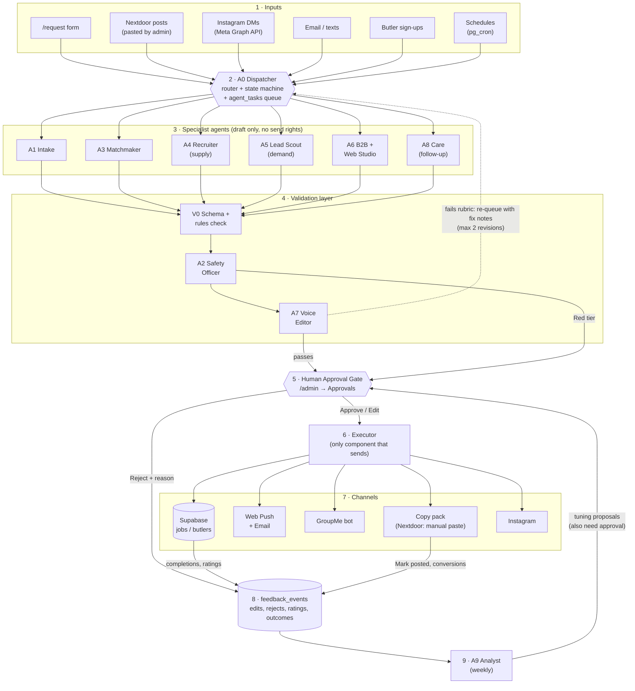
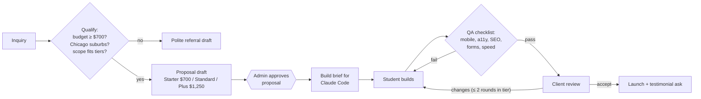
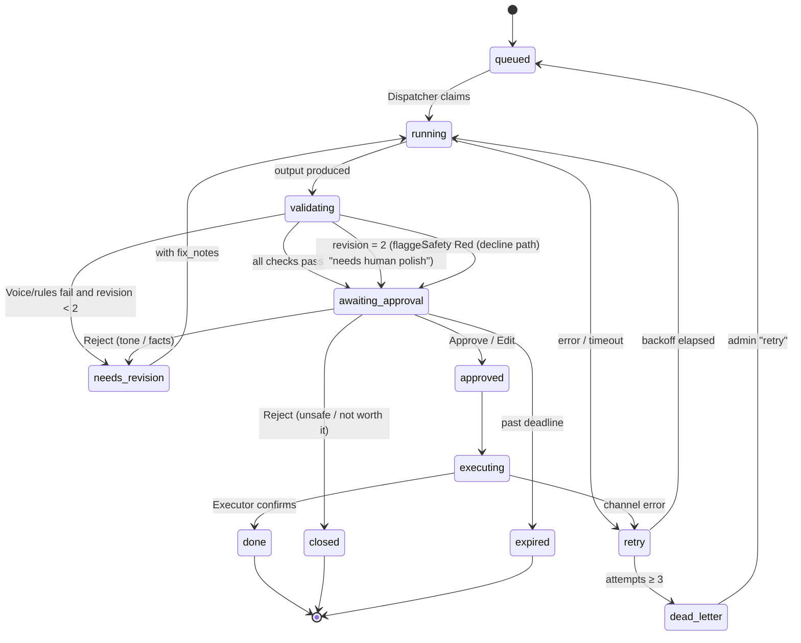
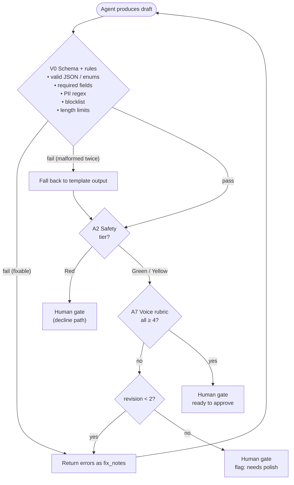
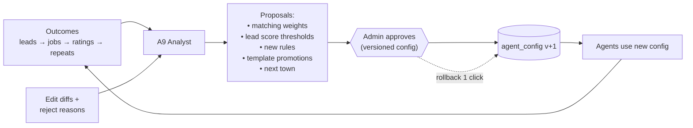
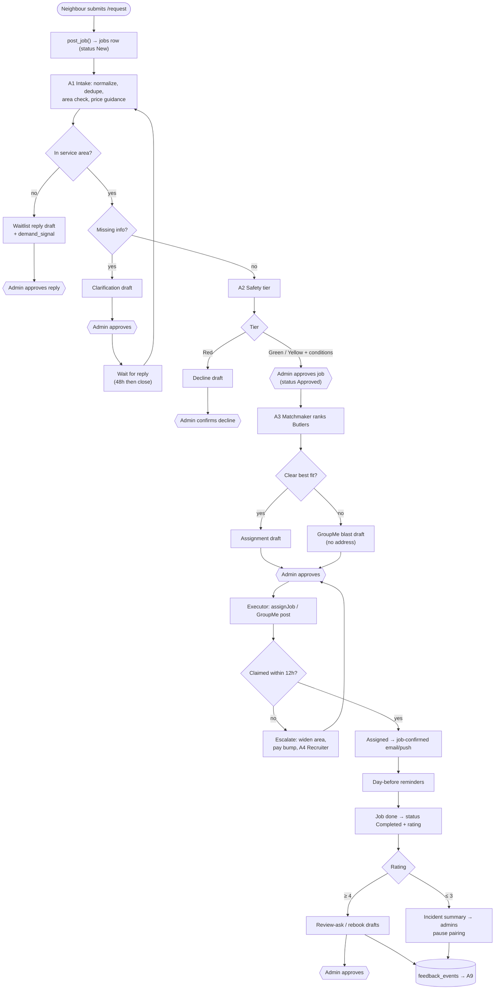
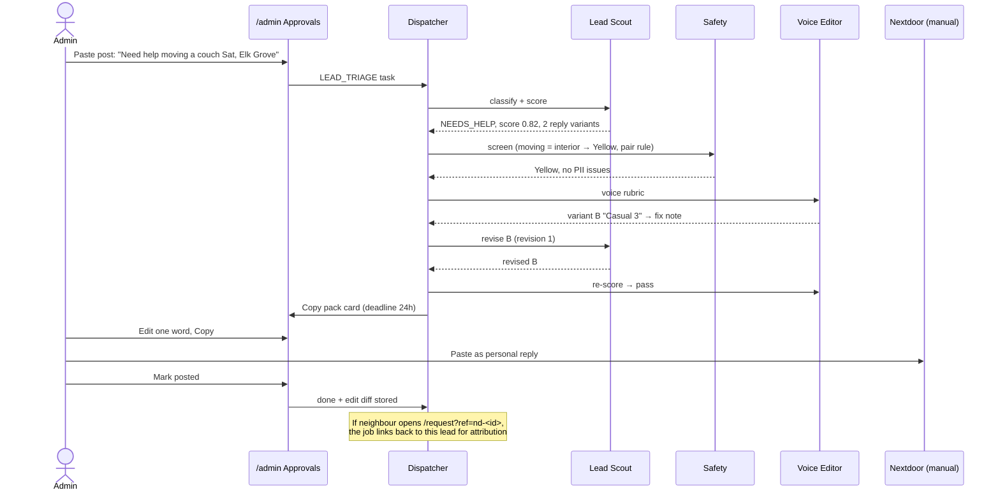
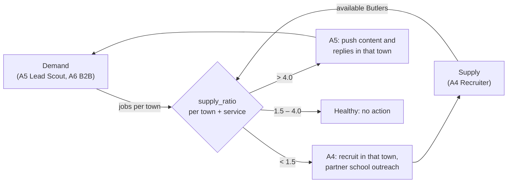
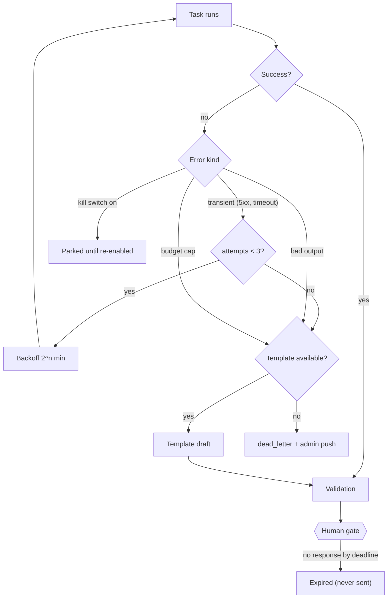

# Community Butler — Multi-Agent Operations System

A design for a team of AI agents that does the repetitive work of running
Community Butler (sorting requests, matching Butlers, drafting outreach,
following up). The three co-admins keep every decision that reaches a
neighbour, a student or the public.

> **Status:** all ten agents are built (A0–A9), with the Executor and
> the Approvals tab in `/admin`. §12 lists what exists and where, and
> "Where the build differs from this design" at the end of it records
> each place the code departs from the text below. Setup: `SETUP.md` §9.

---

## Contents

1. [Design principles](#1-design-principles)
2. [System at a glance](#2-system-at-a-glance)
3. [The agents](#3-the-agents)
4. [Task routing](#4-task-routing)
5. [Validation and refinement loops](#5-validation-and-refinement-loops)
6. [End-to-end flows](#6-end-to-end-flows)
7. [Failure handling](#7-failure-handling)
8. [Optimization](#8-optimization)
9. [Scalability](#9-scalability)
10. [Data model additions](#10-data-model-additions)
11. [Metrics](#11-metrics)
12. [Build order](#12-build-order)
13. [Decisions the co-admins need to make](#13-decisions-the-co-admins-need-to-make)

---

## 1. Design principles

Each principle comes from one of the business's constraints.

| # | Principle | Comes from | What it means in practice |
|---|---|---|---|
| P1 | **Agents draft, humans publish.** | "Automated publishing or outreach must have a human approval step." | No agent has credentials that can send a message to a person or post publicly. Only the **Executor** can, and it acts only on an `approval` row signed by an admin. |
| P2 | **Fail closed.** | Trust & safety; minors in neighbours' homes. | If a validator errors, times out or is unsure, the task goes to a human. It is never approved by default. If no admin answers, nothing goes out. |
| P3 | **Deterministic before generative.** | Small budget; reliability. | Hard rules (service area, banned job types, PII, dedupe) run as plain code before any LLM call. The LLM handles judgement and wording only. |
| P4 | **Every draft has a template fallback.** | Limited time; the API can fail. | This is the same pattern as `supabase/functions/_shared/bio.ts`: when the API is down or there's no key, a plain template output still lets work continue. |
| P5 | **User text is data, not instructions.** | Job details, Nextdoor posts and DMs are written by strangers. | Untrusted text goes into prompts inside delimited blocks. Agents have no tools that a prompt injection could abuse (P1). |
| P6 | **One inbox, ≤ 15 minutes a day each.** | Three part-time co-admins. | All approvals land in one mobile-friendly **Approvals** tab in `/admin`, batched and ranked by urgency, with one-tap actions. |
| P7 | **Learn from every edit.** | Brand voice must stay student-peer, not corporate. | An admin's edit or rejection reason is saved as a training example that later drafts are conditioned on. |
| P8 | **Least privilege per agent.** | Data contains home addresses and minors' details. | Each agent reads only the fields it needs. For example, the Matchmaker's GroupMe blast never sees a street address. |

---

## 2. System at a glance



**How to read it:** follow the numbers. Every input becomes a **task**.
The Dispatcher routes the task to one specialist agent. That agent's output always passes through
the validation layer, and anything leaving the building passes the human
gate. The Executor is the only component with send and post rights.
Outcomes and human feedback flow back to the Analyst, which suggests
improvements. Those suggestions also need approval.

---

## 3. The agents

### Summary

| ID | Agent | One-line job | Model tier* | Runs |
|---|---|---|---|---|
| A0 | **Dispatcher** | Routes tasks, enforces the state machine, retries and escalations | none (code) | every minute |
| A1 | **Intake** | Turns a messy request into a clean, priced, area-checked job | small | on event |
| A2 | **Safety Officer** | Gives every job and outbound message a Green, Yellow or Red tier | rules + medium | on event |
| A3 | **Matchmaker** | Ranks Butlers for a job and drafts the assignment or GroupMe blast | rules + small | on approval |
| A4 | **Recruiter** | Keeps supply ahead of demand per town and service | medium | daily + on signal |
| A5 | **Lead Scout** | Finds neighbours asking for help and drafts personal replies | medium | on paste/event |
| A6 | **B2B + Web Studio** | Runs outreach to realtors, property managers, HOAs and small businesses, and the website pipeline | large (drafts) | on event |
| A7 | **Voice Editor** | Critiques and fixes tone: friendly, local, student-peer | small | on every outbound draft |
| A8 | **Care** | Confirmations, reminders, check-ins, reviews and rebooking | small / template | scheduled |
| A9 | **Analyst** | Weekly metrics, experiment results and tuning proposals | large | weekly |
| — | **Executor** | Sends or posts approved items. Idempotent. | none (code) | on approval |
| — | **Human Approval Gate** | The three co-admins | — | — |

\*Model tiers as designed: **small** = `claude-haiku-5-5`, **medium** =
`claude-sonnet-5-5`, **large** = `claude-opus-5-5`. **As built**, every
agent uses `claude-opus-5-5` and varies the effort level instead (`low`
for classification and voice scoring, `medium` for drafting). Set
`AGENT_MODEL` to change the model. See §8.

Each agent card below lists the agent's **role**, **inputs**, **outputs**,
**decision logic**, and the things it is **not allowed** to do.

---

### A0 — Dispatcher (orchestrator)

**Role:** a plain TypeScript edge function (`agent-dispatcher`), run every
minute by `pg_cron`, plus database triggers that enqueue tasks. It has no
LLM, so routing is predictable, cheap and testable.

| Inputs | Outputs |
|---|---|
| New rows in `jobs`, `butlers`, `leads`, `feedback_events`; schedule ticks; approvals | `agent_tasks` state transitions; invocations of agents; escalation pushes to admins |

**Decision logic**

```text
loop every minute:
  claim up to N tasks WHERE state IN ('queued','retry') AND run_after <= now()
        ORDER BY priority DESC, created_at
        FOR UPDATE SKIP LOCKED            -- safe if two runs overlap
  for each task:
    agent = ROUTES[task.type]             -- table in §4
    if agent.kill_switch_on:  park(task, 'agent_disabled'); continue
    if budget.month_spend >= budget.cap and agent.uses_llm:
        run agent in TEMPLATE mode        -- P4
    result = invoke(agent, task, timeout=agent.timeout)
    on success  -> state = 'validating' -> run validation pipeline (§5)
    on failure  -> attempts++; backoff = 2^attempts min (cap 60);
                   attempts >= 3 -> state = 'dead_letter', notify admins
  sweep SLAs:
    awaiting_approval past deadline -> re-notify once, then 'expired'
    approved job unassigned > 12h   -> enqueue MATCH_ESCALATE
```

**Not allowed to:** call the LLM, or send anything to anyone except admins.

---

### A1 — Intake Agent

**Role:** turns any inbound request (form, pasted Nextdoor post, email or
DM) into a structured, de-duplicated, priced job candidate. Asks a
follow-up question if something is missing.

| Inputs | Outputs |
|---|---|
| Raw request text + any form fields; `service_areas` config; `price_book`; recent jobs from the same contact | `job_candidate` JSON (below); optional **clarification draft**; `demand_signal` row if out of area |

```jsonc
// job_candidate — produced with tool-use / structured output, never free text
{
  "service": "snow_shoveling",          // enum from catalog, or "odd_job" / "website" / "tech_help"
  "segment": "resident",                // resident | realtor | property_manager | hoa | small_business
  "town": "Arlington Heights",
  "in_service_area": true,
  "date_window": { "earliest": "2026-12-03", "latest": "2026-12-04", "urgent": true },
  "size_hint": "2-car driveway + sidewalk",
  "budget_stated": "$40",
  "price_guidance": { "low": 35, "high": 50, "budget_ok": true },
  "missing": [],                        // e.g. ["date", "phone"]
  "duplicate_of": null,
  "confidence": 0.91,
  "notes_for_admin": "Elderly homeowner mentioned — see safety tier."
}
```

**Decision logic**

| Check | Kind | Result |
|---|---|---|
| Same phone/email + same service within 7 days | rule | Merge into the existing job. No new task. |
| Town not in `service_areas` where `active` | rule | Draft a friendly "not there yet, we'll ping you" reply and log a `demand_signal` (this feeds expansion, §9) |
| `service = website` | rule | Hand off to **A6 Web Studio** |
| Service not in catalog | LLM | Classify as `odd_job` and force a Safety review |
| Required field missing | rule | Draft **one** short clarification message covering all gaps (not one per field) |
| Budget below `price_book.floor` | rule | Flag for admin with a suggested counter-range. Never auto-reject. |
| Snow forecast + snow job, or date ≤ 24 h | rule | `priority = high` |
| `confidence < 0.7` | — | Send to the human gate with the raw text side-by-side |

**Not allowed to:** approve a job (`status` stays `New`), quote a binding
price, or contact the neighbour without approval.

---

### A2 — Safety Officer

**Role:** the trust-and-safety gate. Every job is tiered before it can be
approved, and every outbound draft is screened before it reaches a human.
Hard rules run first. The LLM can only **raise** a tier, never lower one.

| Inputs | Outputs |
|---|---|
| `job_candidate` + raw text, or any outbound draft; `safety_policy` config; customer history | `{ tier: Green\|Yellow\|Red, reasons[], conditions[], pii_findings[] }` |

**Decision logic (jobs)**. The thresholds are **suggested defaults** for
the co-admins to confirm (§13):

| Tier | Triggers (examples) | What happens |
|---|---|---|
| **Red** | Roof or ladder work above about 6 ft; chainsaws or tree felling; electrical, gas or pool chemicals; driving the customer; alcohol or firearms present; work after dark; requests for a specific student by appearance; anything sexual or harassing | Agent drafts a polite decline. A human must confirm it. The job can never be auto-routed to Butlers. |
| **Yellow** | Work inside a home (moving, junk hauling, senior tech help); heavy lifting; power tools (power washer, mower for under-16s); vulnerable customer; first-time customer + interior work; > 4 hours | Approve **with conditions**: pair rule (2 Butlers), age minimum, daylight only, parent-aware checkbox. The conditions travel with the job to the Matchmaker as hard filters. |
| **Green** | Outdoor, daylight, standard catalog job, known area | Normal approval path |

**Decision logic (outbound drafts)**. Any of these blocks the draft:

- PII leak: a street address in a group or public message, or a Butler's
  full name, school schedule, phone or area. The public profile rules
  are the same as in `002_butler_profiles.sql`.
- Promises the business can't keep: insurance, guarantees, "background
  checked", or exact prices outside `price_book`.
- Advice outside scope: medical, legal or financial (this matters most
  for **senior tech help**).
- Signs of injected instructions copied from user text.

**Not allowed to:** lower a rule-assigned tier, or approve a Red item.

---

### A3 — Matchmaker

**Role:** for an **approved** job, picks the right Butler(s) and drafts the
assignment, or a GroupMe "job available" blast if nobody is an obvious fit.

| Inputs | Outputs |
|---|---|
| Approved job + safety conditions; Butlers with `profile_status = Approved`; `ButlerStats` (assigned, completed, avg rating); availability; recent load | Top-3 ranked shortlist with reasons; **assignment draft** (uses existing `assignJob` + `notifyMessage`) **or** **GroupMe blast draft** |

**Decision logic**

```text
candidates = butlers WHERE
    profile approved
    AND service in job_type_prefs
    AND meets safety conditions (age min, pair-capable)        -- hard filters
    AND available in job.date_window
score = 0.30 * service_match
      + 0.25 * proximity(town)          -- same town > neighboring > other
      + 0.20 * reliability              -- completion rate, avg rating (Bayesian-smoothed)
      + 0.15 * fairness                 -- fewer jobs in last 14 days scores higher
      + 0.10 * customer_affinity        -- worked for this neighbor before, rated >= 4
      - overload_penalty                -- > 3 open jobs
if pair required: pick best pair (not both first-timers)
if top score >= 0.75 and margin over #2 >= 0.1 -> draft direct assignment
else                                            -> draft GroupMe blast
```

The GroupMe blast contains **only** the service, town, date, estimated
pay and "claim it in the app". It never includes the address or the
neighbour's name. Those are visible only to the assigned Butler, which is
how the existing RLS already works. Claims use the atomic `acceptJob()`,
so two Butlers cannot both win.

**Escalation ladder** (run by the Dispatcher): no claim after 12 h → widen
to neighbouring towns and draft a re-post with a "+$5 bump" suggestion.
After 24 h → alert admins and A4 Recruiter (supply-gap signal). For a
snow job, compress each step to 2 h.

**Weights are config**, not code. A9 Analyst proposes changes to them (§5.3).

---

### A4 — Recruiter (supply side)

**Role:** keeps enough active Butlers, per town and per service, for the
jobs coming in. Drafts recruitment and retention messages.

| Inputs | Outputs |
|---|---|
| Supply ratio per (town, service, week); sign-up funnel state; inactive Butlers; season calendar; partner-school list | GroupMe recruitment posts; partner-school / club outreach emails; onboarding nudges; re-engagement messages; weekly "supply health" line for the digest |

**Decision logic**

```text
supply_ratio(town, service) = available_butlers_next_7d / (open_jobs + forecast_jobs_next_7d)

ratio < 1.0  -> URGENT: draft GroupMe call-out + referral ask to top Butlers
ratio < 1.5  -> draft recruitment post for that town/school
ratio > 4.0  -> tell Lead Scout (A5) to push demand there instead

funnel nudges (template, no LLM):
  account created, no profile after 2 days   -> "finish your profile" push
  profile Pending > 48h                      -> remind ADMINS (not the student)
  profile Rejected                           -> encourage resubmission, quote profile_note
  no job in 30 days                          -> friendly check-in
season pre-loading:
  6 weeks before snow / leaf season          -> recruitment campaign drafts
```

Bio drafting already exists (`draft-bio`) and becomes one of this agent's
tools. It keeps the same rule: the bio stays Pending until a manager approves it.

---

### A5 — Lead Scout (demand side)

**Role:** turns "who needs help near us?" into ready-to-paste, personal
replies, and plans the organic content calendar.

| Inputs | Outputs |
|---|---|
| Nextdoor posts **pasted by an admin** (text or screenshot); Instagram comments/DMs (after Meta app review); emails; area config; recent wins and reviews | Scored `leads`; **Nextdoor copy pack**; IG reply/post drafts; weekly content ideas |

**Decision logic**

```text
classify(post) -> intent:
   NEEDS_HELP          ("anyone know a kid who can shovel?")      -> reply
   ASKING_RECOMMEND    ("recommendations for junk removal")       -> reply
   OFFERING / OFF_TOPIC                                           -> drop
lead_score = fit(service in catalog, safety not Red)
           * area(in active town = 1, adjacent = 0.5, else 0)
           * recency(< 24h = 1, < 72h = 0.6, else 0.2)
           * urgency(weather / move-out date)
score >= 0.5 -> draft reply; else archive with reason
```

**The Nextdoor copy pack:** Nextdoor has no posting API, and replies must
read as a neighbour talking, not a business. So the "output" is a card
the admin copies, pastes, then taps **Mark posted**:

- 1–2 reply variants, written in the **first person as that admin**
  ("Hey! I'm a junior at BHS, a few of us do snow shoveling around
  Arlington Heights…"), 40–90 words, with no hashtags, no all-caps and
  no "our company".
- An optional tracked link (`/request?ref=nd-<leadId>`) so conversions
  can be attributed. The variant without a link is the default for the
  first reply.
- An anti-spam guard: variants are compared to the last 20 posted
  replies. If they are more than 70% similar, they get regenerated, so
  Nextdoor doesn't see copy-paste patterns.

**Not allowed to:** post anywhere. Instagram replies, once the API is
approved, go through the Executor and only after approval.

---

### A6 — B2B + Web Studio

**Role:** the two "bigger-ticket" pipelines.

**(a) B2B outreach.** Real estate agents (pre-listing yard cleanups,
move-outs), property managers, HOAs (common-area leaf and snow), small
businesses.

| Inputs | Outputs |
|---|---|
| Public info about target (brokerage page, HOA site); segment playbook; past results | Lead record + segment; personalised email/DM draft; follow-up sequence (day 0 / 5 / 12) drafts |

Decision logic: qualify on *in service area* × *recurring need* ×
*reachable contact*. Contacts that don't qualify are logged and dropped.
One person gets at most 3 touches, and any reply stops the sequence.

**(b) Website-building service ($700–$1,250).**



**Not allowed to:** send email, commit to a price outside the tier table,
or claim results ("we'll double your traffic").

---

### A7 — Voice Editor (critic)

**Role:** the brand-voice validator. Every outbound draft, from any agent,
is scored against a rubric. If it fails, it goes back with specific
fix-it notes.

| Inputs | Outputs |
|---|---|
| Draft + channel + audience; brand voice guide (cached); last 30 approved-and-edited examples | `{ scores{}, pass: bool, fix_notes[] }` or a minimally edited version |

**Rubric** (1–5 each; pass = every score ≥ 4):

| Dimension | 5 looks like | Auto-fail examples |
|---|---|---|
| Friendly | Warm and direct, like a text from a neighbour's kid | "Dear valued customer" |
| Casual | Contractions, short sentences | Passive voice, legalese |
| Local | Mentions the town or school naturally, once | Generic "your area" |
| Student-peer | "a few of us at BHS…" | "Our team of professionals" |
| Channel fit | Nextdoor: personal, ≤ 90 words. GroupMe: ≤ 3 lines. Email: subject ≤ 6 words. | Hashtags on Nextdoor |
| Truthful | Matches the facts in the task | Invented availability or prices |

Deterministic pre-check: a blocklist of corporate phrases ("leverage",
"solutions", "synergy", "we are pleased to", "valued customer", "premier").

---

### A8 — Care (follow-up)

**Role:** the post-booking lifecycle. Most of it is templated (cheap and
predictable). The LLM is used only to summarise problems.

| When | Action | Existing piece |
|---|---|---|
| Job assigned | Confirmation to neighbour | `job-confirmed` |
| Day before | Reminder to Butler + neighbour | `send-reminders` (cron) |
| Scheduled date + 1 day, not marked done | Nudge Butler; then alert admin | new |
| Completed | Thank-you + 1-tap rating request | new |
| Rating ≥ 4 | Draft "would you recommend us on Nextdoor?" ask (needs approval) | new |
| Rating ≤ 3 or complaint text | **Incident path:** summary + timeline to admins, pause auto-matching that Butler–customer pair | new |
| Seasonal | "Raked your leaves in Oct — want snow help this winter?" rebooking draft | new |

The idempotency timestamps already in `jobs` (`confirmation_sent_at`,
`reminder_sent_at`) are extended to each new step, so a retry can never
double-send.

---

### A9 — Analyst (optimizer)

**Role:** closes the outer feedback loop. It runs weekly (Monday 7am CT)
and produces the digest and tuning proposals.

| Inputs | Outputs |
|---|---|
| `jobs`, `leads`, `agent_runs`, `approvals`, `feedback_events`, `analytics` | Monday digest (push + email to admins); experiment readouts; **config change proposals** (weights, templates, thresholds) |

**Decision logic**

- Funnel by channel and town: lead → reply posted → request → approved →
  completed → repeat.
- Per-agent quality: approval rate, average edit distance, rejection
  reasons. An agent with < 60% approved-as-is for 2 weeks gets flagged for
  a prompt review. A template with > 95% approved-as-is for 4 weeks gets
  proposed for **auto-approval of internal-only actions** (never public posting).
- A/B readouts: only declares a winner at n ≥ 30 per arm. Otherwise it
  reports "keep running".
- Expansion signal: a town with ≥ 10 `demand_signal`s in 30 days, and a
  partner school nearby, gets proposed as the next service area.

---

### Human Approval Gate

One **Approvals** tab in `/admin` (the existing dashboard). Each card shows
the draft, which agent made it and why, the safety tier, the confidence and
the deadline.

| Action | Effect |
|---|---|
| **Approve** | Executor sends or posts. The draft is stored as a positive example. |
| **Edit + approve** | Executor sends the edited text. The diff is stored (strongest learning signal). |
| **Reject** (reason required: *tone / wrong facts / unsafe / not worth it / duplicate*) | The task closes, or goes back for revision if "tone" or "wrong facts". The reason is logged. |
| **Snooze** | Comes back at a chosen time. |

**Approval rules**

- Any outbound message or public post needs 1 admin.
- Declining a Red job needs 1 admin. **Overriding** a Red tier, or changing
  the safety policy, needs **2 different admins**.
- Analyst config changes need 1 admin, and are applied as a versioned
  `agent_config` row that can be rolled back in one click.
- Drafts expire: lead replies after 24 h (stale on Nextdoor), others after
  72 h. An expired draft is archived, never sent late.
- Cards are ranked by `priority × deadline proximity`. A daily push at
  7:30am and 4:00pm says "6 things need you (≈4 min)".

---

## 4. Task routing

### 4.1 Task envelope

Every unit of work is one row in `agent_tasks`:

```jsonc
{
  "id": "uuid",
  "type": "JOB_INTAKE",                 // see routing table
  "source": "request_form",             // request_form | nextdoor_paste | ig | email | cron | agent
  "subject_ref": { "table": "jobs", "id": "uuid" },   // pointer, not a copy of PII
  "parent_task_id": null,               // chains: INTAKE -> SAFETY -> MATCH
  "priority": 2,                        // 0 low … 3 urgent
  "state": "queued",
  "attempts": 0,
  "revision": 0,                        // refinement-loop counter
  "idempotency_key": "job:<id>:intake", // unique — the same event never runs twice
  "safety_tier": null,
  "confidence": null,
  "deadline": "2026-12-03T14:00:00Z",
  "run_after": "now",
  "trace": []                           // agent_run ids for debugging
}
```

### 4.2 Routing table

| Event / trigger | Task type | Agent | Next on success |
|---|---|---|---|
| `jobs` insert (via `post_job`) | `JOB_INTAKE` | A1 | `JOB_SAFETY` |
| Admin pastes text into "New lead" | `LEAD_TRIAGE` | A5 (A1 if it's clearly a job) | `REPLY_DRAFT` |
| Intake complete | `JOB_SAFETY` | A2 | Approval card (approve job) |
| Admin approves job | `JOB_MATCH` | A3 | Approval card (assignment/blast) |
| No claim after 12 h / 24 h | `MATCH_ESCALATE` | A3, then A4 | Approval card |
| Butler sign-up / intake submitted | `BUTLER_ONBOARD` | A4 (+ `draft-bio`) | Profile review card |
| Daily 6am | `SUPPLY_CHECK` | A4 | Recruitment drafts if needed |
| Job status → Completed | `JOB_FOLLOWUP` | A8 | Review-ask draft / incident |
| Rating ≤ 3 | `INCIDENT` | A8 → A2 | Admin card (priority 3) |
| Website inquiry | `WEB_LEAD` | A6 | Proposal card |
| B2B list import | `B2B_OUTREACH` | A6 | Email drafts |
| Monday 7am | `WEEKLY_REVIEW` | A9 | Digest + config proposals |
| Any outbound draft | `VALIDATE` | V0 → A2 → A7 | Approval card |
| Approval granted | `EXECUTE` | Executor | `done` |

### 4.3 Task state machine



---

## 5. Validation and refinement loops

There are three loops, each slower and broader than the one before.

### 5.1 Inner loop: draft → validate → revise (seconds)



The revision cap of **2** is deliberate. A third LLM pass rarely beats
a human spending 20 seconds on it, and the cap keeps the cost of a bad
day bounded.

### 5.2 Middle loop: human feedback (per approval)

- **Approve as-is** → stored as a positive few-shot example for that
  agent + channel.
- **Edit + approve** → the `(draft, final)` pair is stored. A7 Voice Editor
  and the drafting agent both get the most recent 30 pairs in their
  (cached) prompt. This is how "sound like us" is learned without
  fine-tuning.
- **Reject with reason** → counted per agent. "Wrong facts" also creates a
  `rule_candidate` so the Analyst can propose a deterministic check, which
  means that mistake class stops depending on the LLM.

### 5.3 Outer loop: outcomes (weekly)



### 5.4 When is a task "complete"?

A task is `done` only when **all** of these hold:

1. The Executor has confirmation from the channel (DB write, email
   accepted by Resend, GroupMe 2xx) **or** an admin tapped "Mark posted"
   for a manual Nextdoor copy pack.
2. The matching idempotency timestamp is set.
3. Any follow-up task it implies (for example `JOB_FOLLOWUP` after
   completion) has been enqueued.

---

## 6. End-to-end flows

### 6.1 A job, from request to review



### 6.2 A Nextdoor lead



### 6.3 The supply-demand balancing loop



This loop is the core of the business: supply and demand have to grow
together, and the agents watch the ratio so the admins don't have to.

---

## 7. Failure handling

| Failure | Detection | Automatic response | Human sees |
|---|---|---|---|
| Anthropic API error / timeout | HTTP error, > 30 s | Retry ×3 with backoff (1, 2, 4 min), then **template mode** | Card marked "template draft" |
| Malformed model output | V0 schema check | 1 retry with the validation error in the prompt, then template | Nothing unless the template also fails |
| Low confidence (< 0.7) | Agent self-report + V0 | Skip auto-steps, go straight to the gate with raw input side-by-side | "Low confidence" badge |
| Revision loop doesn't converge | `revision = 2` | Stop and send to human | "Needs polish" badge |
| Prompt injection in user text | Delimiters + A2 check + no tools for agents | Draft blocked; raw text shown as quoted data | Red badge |
| No admin acts | Deadline sweep | Re-notify once, then **expire** (fail closed) | Missed items in Monday digest |
| Executor channel down (Resend, GroupMe, Meta) | Non-2xx | Retry with backoff; idempotency key prevents duplicates; dead-letter after 3 | Dead-letter card with "retry" button |
| Double-run of cron / duplicate event | Unique `idempotency_key`; `FOR UPDATE SKIP LOCKED` | Second run is a no-op | — |
| Two Butlers claim one job | Atomic `acceptJob()` (already returns `false` to the loser) | Loser gets "already taken" + next suggestion | — |
| Butler no-show | Job date + 1 day, not completed, no check-in | Ping Butler, then admin; offer neighbour a reassignment draft | Priority-3 card |
| Safety incident reported | Rating ≤ 3 with keywords, or direct report | Pause the Butler–customer pair, summarise, **page all 3 admins** | Incident card at top |
| Monthly LLM budget hit | `agent_runs.cost` sum ≥ cap | All agents switch to template / rules-only. Analyst is skipped. | Banner in `/admin` |
| An agent misbehaving | Approval rate drops, admin report | **Kill switch** per agent in `agent_config` (Dispatcher parks its tasks) | Toggle in settings |
| Bad config change | Metrics drop after deploy | One-click rollback to previous `agent_config` version | Analyst flags it next week |
| Meta app review still pending | Missing token | A5 produces IG drafts as copy packs (same as Nextdoor) | — |



---

## 8. Optimization

**Cost.** The goal is tens of dollars a month, not hundreds.

1. **Rules first (P3).** Dedupe, area check, pricing, PII, blocklists and
   all Care-agent messages are code or templates. Probably 60–70% of
   tasks never call an LLM.
2. **Model tiering.** Classification and extraction (Intake, lead
   classify, Voice scoring) use `claude-haiku-5-5`. Drafting and judgement
   (Lead Scout replies, Safety nuance, Recruiter) use `claude-sonnet-5-5`.
   `claude-opus-5-5` is used only for the weekly Analyst and website
   proposals.
3. **Prompt caching.** The brand voice guide, safety policy, service
   catalog and few-shot examples form a stable prefix per agent, cached
   across calls. Only the task-specific suffix changes.
4. **Structured outputs.** Tool-use / JSON schema output removes the
   parse-and-retry tax and makes V0 trivial.
5. **Minimal context.** Agents get pointers and the fields they need, not
   whole rows. This is cheaper and limits PII exposure (P8).
6. **Batching.** Analyst, supply check and B2B enrichment run as nightly
   or weekly batches.
7. **Cost ledger.** Every `agent_runs` row records tokens and cost, so
   each agent's cost per *approved* output is visible in the digest.

**Admin time.**

- One inbox, ranked, batched into two daily pushes.
- One-tap approve on mobile. "Edit" opens the text pre-selected.
- Template promotion (§3 A9) gradually removes approval steps for
  **internal-only** actions such as nudging a Butler to finish their
  profile. Anything a neighbour or the public sees always keeps the gate.

**Quality.**

- Track approval-as-is rate and edit distance per agent and channel.
- A/B test reply styles (with vs. without link, mentioning school vs.
  not) with the `ref` attribution, and only call winners at n ≥ 30.
- Golden test set: 30 real past requests and posts with known-good
  outputs. Re-run on every prompt or config change before it ships (§12).

---

## 9. Scalability

### 9.1 Growth phases

| Phase | Footprint | What changes |
|---|---|---|
| **0 — Now** | Barrington, 3 admins | Run A1 + A5 as **Claude Code prompts** the admins use by hand. No infrastructure. Validates prompts and voice. |
| **1 — Automate the core** | + Arlington Heights | `agent_tasks`, Dispatcher, Approvals tab, A1/A2/A3/A8. GroupMe bot via Executor. |
| **2 — Multi-town** | + Elk Grove, Schaumburg | `service_areas` + per-town GroupMe groups; A4 supply ratio per town; **area captains** (trusted student leads) approve *internal* items for their town via scoped RLS. Public posts stay with admins. |
| **3 — Multi-school chapters** | Partner schools run their own | `chapter_id` on every table; RLS by chapter; per-chapter `agent_config`, voice examples and safety policy (stricter-only overrides). Shared agents, isolated data. |
| **4 — New segments at volume** | B2B, websites, tech help | A6 split into separate B2B and Web Studio agents; recurring contracts (HOA seasonal) become scheduled job generators. |

### 9.2 Technical scaling notes

- **Queue:** Postgres with `FOR UPDATE SKIP LOCKED` comfortably handles
  thousands of tasks a day, far beyond expected volume. If it ever isn't
  enough, move the Dispatcher to a dedicated worker. The table and
  contract stay the same.
- **Partitioning:** route by `chapter_id` / `town`, so one busy town's snow
  surge can't starve another's queue (per-partition concurrency limits).
- **Rate limits:** a per-provider token bucket in the Executor (GroupMe,
  Resend daily cap of 100 on the free tier, Meta).
- **Config over code:** new towns, services, prices and safety rules are
  rows, not deploys.
- **Human gate scales by delegation, not removal:** more approvers with
  scoped roles, never fewer gates on public or safety-relevant actions.
- **Observability:** `agent_runs` (input hash, output, model, tokens, cost,
  latency, validator results) gives a full trace per task from the
  `/admin` card.

---

## 10. Data model additions

This sketch follows the conventions in `supabase/schema.sql`: RLS on
everything, admin-only reads, writes through the service role or narrow
`security definer` RPCs.

```sql
create table public.agent_tasks (
  id               uuid primary key default gen_random_uuid(),
  type             text not null,
  source           text not null,
  subject_table    text, subject_id uuid,          -- pointer, not a PII copy
  parent_task_id   uuid references public.agent_tasks(id),
  priority         int  not null default 1,
  state            text not null default 'queued'
                     check (state in ('queued','running','validating','needs_revision',
                       'awaiting_approval','approved','executing','done',
                       'retry','dead_letter','closed','expired','parked')),
  attempts         int not null default 0,
  revision         int not null default 0,
  idempotency_key  text not null unique,
  safety_tier      text check (safety_tier in ('Green','Yellow','Red')),
  confidence       numeric,
  draft            jsonb,                           -- latest output
  deadline         timestamptz,
  run_after        timestamptz not null default now(),
  created_at       timestamptz not null default now(),
  updated_at       timestamptz not null default now()
);
create index on public.agent_tasks (state, run_after, priority desc);

create table public.agent_runs (           -- one row per LLM/agent call
  id uuid primary key default gen_random_uuid(),
  task_id uuid references public.agent_tasks(id) on delete cascade,
  agent text not null, model text, mode text,      -- 'llm' | 'template'
  input_tokens int, output_tokens int, cost_usd numeric,
  latency_ms int, validator jsonb, error text,
  config_version int, at timestamptz not null default now()
);

create table public.approvals (
  id uuid primary key default gen_random_uuid(),
  task_id uuid not null references public.agent_tasks(id),
  admin_id uuid not null references public.admins(id),
  decision text not null check (decision in ('approve','edit','reject','snooze')),
  reason text, final_text text,
  at timestamptz not null default now()
);
-- Two-admin rule for Red overrides is enforced in a security definer RPC,
-- not the UI (same reasoning as butlers_guard_publication()).

create table public.leads (
  id uuid primary key default gen_random_uuid(),
  channel text not null,                 -- nextdoor | instagram | email | b2b | web
  segment text, town text, raw_text text,
  score numeric, status text not null default 'new',
  job_id uuid references public.jobs(id),         -- set on conversion
  created_at timestamptz not null default now()
);

create table public.feedback_events (    -- edits, rejects, ratings, outcomes
  id uuid primary key default gen_random_uuid(),
  kind text not null, agent text, task_id uuid, payload jsonb,
  at timestamptz not null default now()
);

create table public.agent_config (       -- versioned, rollback = re-activate old row
  version serial primary key,
  config jsonb not null,                 -- weights, thresholds, kill switches, budget cap
  active boolean not null default false,
  approved_by uuid references public.admins(id),
  at timestamptz not null default now()
);

create table public.service_areas (town text primary key, active boolean, adjacent text[]);
create table public.price_book (service text primary key, floor int, low int, high int);
create table public.demand_signals (id uuid primary key default gen_random_uuid(),
  town text, service text, at timestamptz not null default now());
```

---

## 11. Metrics

| Area | Metric | Healthy target (initial guess) |
|---|---|---|
| Demand | Lead → request conversion, per channel | Nextdoor ≥ 15% |
| Demand | Request → completed job | ≥ 70% |
| Supply | Supply ratio per active town | 1.5 – 4.0 |
| Supply | Butler 30-day active rate | ≥ 50% |
| Speed | Request → approved (median) | < 4 h (daytime) |
| Speed | Approved → assigned (median) | < 12 h (snow < 3 h) |
| Quality | Average job rating | ≥ 4.5 |
| Quality | Drafts approved as-is | ≥ 70% after week 6 |
| Safety | Red items reaching a Butler | **0** (hard) |
| Safety | PII leaks in group/public posts | **0** (hard) |
| Admin load | Minutes per admin per day in the Approvals tab | ≤ 15 |
| Cost | LLM spend / month | under the cap set in `agent_config` |

---

## 12. Build order

This order is sized for three people with school schedules. Each step is
useful on its own.

**Built (steps 2–7):**

| Piece | Where |
|---|---|
| Agent core (pure TypeScript; runs in Deno, the browser and Node) | `supabase/functions/_shared/agents/` |
| Unit tests (`npm test`) | `supabase/functions/_shared/agents/agents.test.ts` |
| Tables, RLS, `submit_lead`, `claim_agent_tasks` | `supabase/migrations/004_agents.sql` |
| Dispatcher (cron every 5 min, or "Run agents now") | `supabase/functions/agent-dispatcher/` |
| Approval Gate + Executor | `supabase/functions/agent-decide/`, `_shared/agentRuntime.ts` |
| Claude connection (structured outputs, `fallbacks: "default"`, prompt caching) | `supabase/functions/_shared/agentLlm.ts` |
| A4 Recruiter: supply gaps, surplus towns, season run-ups, profile nudges, check-ins | `_shared/agents/recruiter.ts` |
| A6 B2B outreach (3 touches) and Web Studio (proposal, referral, build brief) | `_shared/agents/b2b.ts` |
| A9 Analyst: weekly review and config proposals | `_shared/agents/analyst.ts` |
| Prospects, `system` tasks, `submit_prospect`, `set_lead_status` | `supabase/migrations/005_more_agents.sql` |
| Approvals tab, Prospects panel, and the browser runtime for demo mode | `src/components/Approvals.tsx`, `src/lib/agents/` |

**Where the build differs from this design:**

- **Planning.** No database triggers. Every run, the Dispatcher works
  out which tasks the current jobs imply and inserts the missing ones by
  idempotency key. Demo mode has no triggers either, so both modes use
  the same mechanism.
- **Model failures.** The SDK retries twice. After that the agent drops
  straight to its template for that task, instead of retrying the whole
  task three times.
- **No separate tables** for `approvals`, `feedback_events`,
  `service_areas`, `price_book` or `demand_signals`. Decisions are stored
  on the task (`agent_tasks.decisions`). Towns and prices live in
  `agent_config`. A waitlisted request is recorded through the job's
  reject note.
- **Approvals in demo mode.** Drafts come from templates only (an API
  key must never reach a browser). Job status changes are real; messages
  are shown for you to send yourself.
- **Recruiter, B2B and Analyst plan their own work.** They look across
  the whole roster or week rather than one row, so each finding becomes
  its own `system` task with a weekly key (for example
  `recruit:gap:Barrington:Snow shoveling:2026-W43`). When its turn comes
  the finding is recomputed, and the card is closed if it no longer applies.
- **Recruiter scope.** Partner-school outreach is a variant of the GroupMe
  post, not a separate email campaign. The profile nudge and the
  waiting-review reminder only fire on the hosted backend, because demo
  Butlers have no profile status.
- **B2B research.** The agent doesn't browse the web. An admin pastes what
  they know about the business into Prospects, and the agent works from
  that.
- **Website inquiries** are entered by an admin in Prospects. There is no
  public inquiry form yet.
- **Analyst.** The weekly review is a card in the inbox, not an email.
  Proposals that change policy apply as a new `agent_config` version.
  Undo it by re-activating the previous version (`SETUP.md` §9). Lead →
  job attribution (`?ref=` links) isn't built, so the review counts posts
  and replies, not bookings per channel.
- **Golden set.** Step 1's golden set is not built yet. The unit tests
  cover the rules, the refinement loop and the approval rules, but they
  don't score draft quality.

1. **Week 1: prompts only (Phase 0).** Write the brand voice guide,
   safety policy and service catalog as markdown. Use them in Claude Code
   by hand for Intake and Nextdoor replies. Collect 30 examples into a
   golden set.
2. **Week 2–3: the spine.** `agent_tasks`, `agent_runs`, `approvals`, the
   Dispatcher, and the Approvals tab in `/admin`. Wire the existing
   `draft-bio` through it as the first agent, since it's already built.
3. **Week 4: A1 Intake + A2 Safety** on new `/request` jobs.
4. **Week 5: A5 Lead Scout copy packs + A7 Voice Editor.** This has the
   biggest demand win, because Nextdoor is the best channel.
5. **Week 6: A3 Matchmaker + GroupMe bot Executor.**
6. **Week 7: A8 Care** (extend the existing `job-confirmed` and
   `send-reminders`).
7. **Week 8+: A4 Recruiter, A9 Analyst, then A6** when the website service
   has its first clients.

Before every prompt or config change, re-run the golden set and compare
approval-as-is scores. Treat it like a unit test.

---

## 13. Decisions the co-admins need to make

These are policy choices, not engineering ones, so the design leaves them
as config with suggested defaults:

1. **Safety thresholds:** the exact Red/Yellow lists, minimum ages per
   service (power washer? mower?), and whether interior jobs always need
   a pair.
2. **Parent awareness:** should Yellow jobs require a parent-aware
   checkbox from the Butler before they can claim?
3. **Who approves what:** is one admin enough for everything except Red
   overrides, and when do area captains get scoped approval rights?
4. **Price book:** floor, low and high per service per town.
5. **Budget cap:** the monthly LLM spend at which agents fall back to
   templates.
6. **Nextdoor identity:** which admin's account posts which towns, so
   replies stay personal and consistent.
